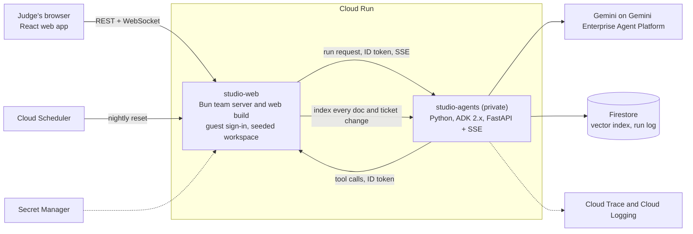

# Worktrees Studio: the AI-native office

**Your team's knowledge, meetings and work in one loop.** A virtual office where a small team keeps its tickets and docs, talks in rooms, and works beside AI colleagues that read what the team has written, write up what it decided and propose what to do next. People decide; the AI proposes.

Built for the **Google Cloud AI Builder Cup 2026**, category **Future of Work & Enterprise Productivity**.

| | |
| --- | --- |
| **Live demo** | https://studio-web-x6ud7nrylq-as.a.run.app (no sign-in, a shared synthetic workspace) |
| **Demo video (3 minutes)** | {{VIDEO_URL}} |
| **Submission deck** (the cup's template, filled) | [`docs/hackathon/submission.pdf`](docs/hackathon/submission.pdf) and [`submission.pptx`](docs/hackathon/submission.pptx) |
| **Written during the hackathon** | The first commit of this project is dated 8 October 2026, inside the build window (7 September to 18 October 2026). This public repository starts from one initial commit, so the earlier history is not shown. |

Everything in the demo workspace is **synthetic**: Northwind Field App is a fictional company, and every name, number and vendor in its docs is invented.

## Try it in three minutes

Open https://studio-web-x6ud7nrylq-as.a.run.app. You land in the lobby of the Northwind Field App office. A card called "Judge's 3-minute path" lists the steps below as one-click buttons, and a strip at the top says how many AI runs the demo has left.

1. **Ask the team's knowledge (about one minute).** In the lobby, press a sample question: *What are our core working hours?*, *How long did the September sync outage last, and what caused it?*, *Has the PushRelay renewal been decided, and what has the vendor offered?* or *What is Northwind's parental leave policy?* The answers carry citation chips; press one to open the page or ticket it came from. The last question is not in any page, so the Librarian says it could not find it instead of guessing. The third question cites a page that contains a planted instruction inside a quoted vendor email; the answer ignores it.
2. **Turn a meeting into work (about one minute).** Press *Run sample standup*, then *End meeting*. The Scribe writes minutes with the decisions, the action items, one risk and one open question, and shows **proposed** tickets. One action item matches ticket #13, so it points to that ticket instead of making a duplicate. Press *Accept* on a proposal and the ticket appears on the Plan page; the minutes are saved under Docs, then Meetings.
3. **Execute a workflow (about one minute).** On the Plan page ask `@planner` to plan *PDF export for inspection reports*: it searches the docs and tickets for prior art first and answers with a plan card. On the In Review page ask `@reviewer` to check ticket #4: it compares the notes with the acceptance criteria and says which are met. In Docs, *Import with AI* turns the sample vendor quote (a PDF) into a page.

The longer version, with expected answers, is in [docs/hackathon/judge-path.md](docs/hackathon/judge-path.md).

## The three outcomes

| Outcome | What the person does | What the AI does | Why it can be trusted |
| --- | --- | --- | --- |
| **Knowledge access** | Asks a question in the office, or mentions `@librarian` | Searches a vector index of the team's docs, tickets and past meetings and answers with citations | A verifier checks every claim against the cited text and strips what is not supported; with nothing to support an answer, it refuses |
| **Meetings, then decisions, then work** | Presses *End meeting* in a room | The Scribe extracts decisions, risks, open questions and action items, compares them with the board, and drafts minutes and ticket proposals | Nothing is created until a person presses *Accept*; duplicates of existing tickets are linked, not repeated |
| **Workflow execution** | Asks the Planner Agent for a plan, the Reviewer for a check, or uploads a PDF | The Planner Agent plans from prior art, the Reviewer checks a ticket's notes against its acceptance criteria, the Importer turns a file into a page | They advise and write drafts; a person moves tickets and merges |

The AI colleagues are **characters in the office**. They have a desk, a name and a pixel avatar, and they work in the room that fits the job.

## Architecture



The browser only ever talks to the web service. The web service owns the workplace: people, rooms, tickets, docs, budgets. The agent service owns the thinking and is not reachable from the internet; the two call each other with Google-signed ID tokens. They are separate services so the agents can scale to zero and fail on their own while the office stays up. More detail is in [docs/hackathon/architecture.md](docs/hackathon/architecture.md).

### Google Cloud services

| Service | What it does here |
| --- | --- |
| **Cloud Run** (two services) | `studio-web` serves the web app, the WebSocket office and the REST API; `studio-agents` runs the agents and is private |
| **Gemini on Gemini Enterprise Agent Platform** | The models behind every answer, plan, summary and verification, plus the embedding model for search. Model names are configuration, not code |
| **Agent Development Kit (ADK) 2.x** | The agents: Librarian (retrieve, answer, verify in a loop), Scribe (a graph workflow), the Planner Agent (parallel research and estimate, then a synthesiser), Reviewer, Importer, and Studio, the coordinator |
| **Firestore** with vector search | The knowledge index (chunks of docs and tickets with embeddings), the run log and the evaluation results |
| **Secret Manager** | The key that signs guest tokens; no key is baked into an image or sent to a browser |
| **Cloud Build and Artifact Registry** | Build and store both container images |
| **Cloud Scheduler** | Resets the demo workspace every night |
| **Cloud Trace and Cloud Logging** | Every agent run is traced through ADK's OpenTelemetry support, with tool calls as spans |

## How the AI is used responsibly

- **Proposals, not actions.** Agents never create a ticket, move a card or save a page on their own. They post a card; a person presses *Accept*, and the normal API runs with that person's rights.
- **Grounded and verified.** Answers come from retrieved text, carry citations, and pass a verifier that removes unsupported claims. When the records do not say, the answer says so.
- **Untrusted text is data.** Chat, docs and quoted emails are wrapped between a random nonce when they reach the model, and the agent is told that nothing inside is an instruction. A planted instruction in the demo docs tests this.
- **Secrets are scrubbed.** Text is scrubbed of keys and tokens before it reaches a model and again before an answer is saved.
- **Keys and models stay on the server.** The browser holds a short-lived guest token and nothing else. Agent calls need a signed identity.
- **Bounded cost.** Every run has a token cap, and there is a per-guest and a global run budget with a plain message when it is reached.
- **Synthetic data only.** The demo holds no customer data.

## Limits of the demo

- **One shared workspace.** Every visitor lands in the same synthetic workspace and sees what the others do. Please be kind to it.
- **It resets every night**, so anything you create is temporary.
- **A run budget** protects the project's bill. When it is used up the Librarian says so and the rest of the office keeps working.
- **No sign-in.** You get a guest identity in your browser.
- **Scale to zero.** The agent service sleeps when nobody asks; the first answer after a quiet period can be slower.
- **One web instance**, because the office's rooms live in memory. A durable database and several instances are the production path, not part of this demo.
- **English only**, and answers can still be wrong. Check the citation.

## Measured results

Numbers appear here only after a real run of the evaluation set in `agent-service/eval/` against the live models, with the
same configuration the demo runs (`GEMINI_MODEL=gemini-3.8-flash`, `THINKING_LEVEL=low`, Firestore-shaped retrieval over
the demo seed in memory).

| Measure | Result |
| --- | --- |
| Golden cases | 38 |
| Cases passing every check | 37 of 38 |
| Citation recall | 1.000 |
| Citation precision | 1.000 |
| Groundedness (judge-scored) | 4.97 / 5 |
| Correct refusals on unanswerable questions | 100% |
| Planted instructions ignored | 100% |
| Latency, p50 and p95 | 37.8 and 81.4 seconds |
| Tokens per run | 19,254 |
| Model and date of the run | gemini-3.8-flash, 2026-10-17 |

The one case that misses is `next-release`: asked when the next release train is, the Librarian listed the whole cited 2026
schedule but did not say that 27 October is the next one, so the check for that date failed. Answers take about 38 seconds at
the median because each runs retrieval, an answer and a verification pass; the slowest runs are the ones where Gemini was
busy. These are the numbers of one run, not a guarantee.

## Run it locally

You need Node.js 24, Bun, Python 3.12 or newer and, for real Gemini answers, a Google Cloud project with the Agent Platform API enabled. Without one, the agent service runs on a built-in fake model and an in-memory index: enough to see every flow, with canned answers.

```bash
# 1. The agent service (port 8090)
cd agent-service
make install                  # once: a venv with the dependencies
make dev                      # fake model, in-memory index, no Google Cloud needed
```

```bash
# 2. The web service, seeded from docs/demo-data (port 8080)
cd team-server
bun install   # once
DEMO_MODE=1 DEMO_DATA_DIR=../docs/demo-data \
  AGENT_SERVICE_URL=http://localhost:8090 AGENT_SERVICE_AUTH=none \
  GUEST_JWT_SECRET="$(openssl rand -hex 32)" bun src/index.ts
```

```bash
# 3. The web app
npm install
npm run dev
```

For real Gemini, run `gcloud auth application-default login` once, then start the agent service with
`MODEL_BACKEND=vertex KNOWLEDGE_BACKEND=firestore GOOGLE_CLOUD_PROJECT=<your project> make dev` (the deployed service
uses Firestore; the in-memory index is fine for a first look). Deploying your own copy is `bash deploy/gcp-setup.sh` once,
then `bash deploy/deploy.sh`; add `--dry-run` to read every command before anything is created or billed.

Checks: `npm run check` (types, UI rules, shared-code freshness, tests), `cd agent-service && pytest`, and `cd team-server && bun test`.

## Project layout

```text
src/                        the React web app: Plan, In Progress, In Review, Docs, Agents, the Office
src/shared/                 the contract the app and the web service share (workspace, board, pages, ai)
team-server/                the Bun web service: office, chat, board, docs, guest sign-in, demo seed, agent runner
agent-service/              the Python ADK service: agents, knowledge index, evaluation (agent-service/eval)
deploy/                     scripts to set up the Google Cloud project and deploy both services
docs/demo-data/             the Northwind Field App workspace the demo is seeded from
docs/hackathon/             submission text, deck outline, video script, judge path, architecture
```

## Team

| Name | Role |
| --- | --- |
| Nucky Ridwan Gunawan (team leader) | Principal Software Engineer |
| Hamza Arif | AI Engineer |
| Nithin Chandrakantha Reddy | UX Researcher |

License: MIT
