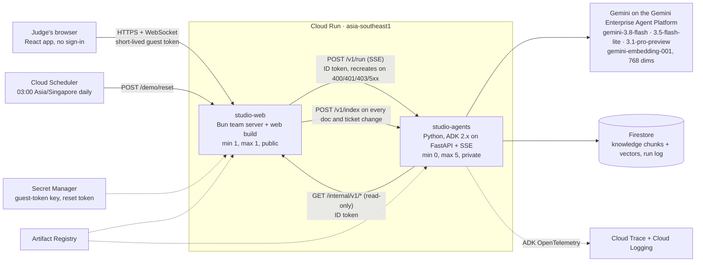

# Architecture: the AI-native office

The live demo is two Cloud Run services in one Google Cloud project. The browser only ever talks to the first; the second is
private and reachable only through a Google-signed identity.

## Why two services

The workplace and the thinking have different shapes. `studio-web` holds the office in memory (rooms, presence, sessions,
chat) and must stay up and warm; `studio-agents` is stateless, scales to zero when nobody asks, and can be redeployed or fail
without taking the office down. The split also makes the trust boundary visible: the agent service has no public address, and
both directions of traffic carry a Google-signed ID token whose audience is the receiving service's own URL.

## What runs where

| Piece | Where | Notes |
| --- | --- | --- |
| React app (Plan · In Progress · In Review · Docs · Agents · Office) | `/app/web` inside `studio-web` | A plain Vite build, served by the same service as the API, so the page talks to its own origin |
| Office, chat, board, docs, guest sign-in, run budgets | `studio-web` (Bun) | `DEMO_MODE=1`: guests become the owner of one seeded workspace; rooms live in memory, hence exactly one instance |
| Seeding and nightly reset | `studio-web` `src/demo/` | The Northwind Field App seed (22 pages, 16 tickets, 6 agents, a scripted standup) is read from `/app/demo-data` and loaded at boot; `POST /demo/reset` (token in Secret Manager) puts it back |
| Agents: Librarian, Scribe, Planner, Reviewer, Importer, Studio | `studio-agents` | Each is a Google ADK 2.x `Workflow`; FastAPI serves `/v1/run` as server-sent events |
| Knowledge index | Firestore | Chunks cut at headings with deterministic ids (`doc:<id>:<n>`), 768-dimension embeddings, `find_nearest` with cosine distance over a flat vector index |
| Guest tokens | Secret Manager → `studio-web` | HS256 JWT signed with a 256-bit random secret; 7-day expiry; the browser holds only this |
| Reset token | Secret Manager → Cloud Scheduler | `x-reset-token` on `POST /demo/reset` |

## The run loop

1. A person @mentions an agent (or presses **End meeting** / **Import with AI**). The team server checks who may ask, takes
   a run from the per-guest and global budgets, and marks the run as server-driven.
2. `studio-web` calls `POST /v1/run` on `studio-agents` with an ID token, streaming back `status` and `step` events that
   become "Librarian is preparing the answer · Searching the team's knowledge" in every window.
3. The pipeline runs. Agents read only through tools (`search_knowledge`, `get_document`, `list_tickets`, `get_ticket`,
   `recent_messages`) that call back into `studio-web`'s read-only `/internal/v1/*` with an ID token.
4. The `final` event carries the answer, its citations, any proposal card, and usage (model, tokens, seconds). The team
   server scrubs it, stores it under a deterministic message id (`a:<question>:<handle>`, so a retry never posts twice) and
   broadcasts it to everyone in that room.
5. Nothing is created by an agent. A **proposal** card is rendered with checkboxes; when a person presses **Accept**, the
   normal REST API runs with that person's own rights and creates the tickets and minutes.

Every run is bounded: a wall-clock timeout (240 s default), a token budget across all its model calls, a per-guest hourly
and a global daily run budget in the team server, and a model chain (primary, then fallbacks) that retries 429/503 with
backoff. A failure sends a plain sentence to the room and refunds the guest's run.

## The agents as workflows (ADK 2.x)

| Agent | Shape | Output |
| --- | --- | --- |
| **Librarian** | retriever (tools) → answerer (claims) → verifier → revise loop (max 2) → gate | Cited answer; refuses when no passage supports it |
| **Planner Agent** | parallel researcher ∥ estimator → join → synthesizer | `plan` or `ask` card (structured output) |
| **Scribe** | extractor → board linker → minutes writer | Minutes + one `proposal` card (tickets with `duplicateOf` for work already tracked) |
| **Reviewer** | inspector (tools) → criterion judge | Checklist per acceptance criterion, recommendation, cited evidence |
| **Importer** | one multimodal call with the file attached | `doc` proposal item the server turns into a Docs page |
| **Studio** | router (structured `Route`) → delegates to the pipeline above | One office, one entry point |

## Trust boundaries and prompt-injection defence

- **Untrusted text is data.** Chat, docs, tickets, quoted emails and tool results reach a model only between markers made of
  a fresh random nonce, with the rule that nothing inside them is an instruction. The demo's `pushrelay-renewal-thread`
  page contains a planted instruction for summarising assistants; the evaluation set measures that the answers ignore it.
- **Verification, not trust.** Every Librarian claim is checked against the passages it cites by a second, cheaper model
  call; unconfirmed claims are rewritten once and then removed. With nothing left, the answer is the refusal.
- **Secrets never travel.** Text is scrubbed of credential-shaped strings before it reaches a model and before an answer is
  saved; indexing scrubs documents too. No API key exists anywhere in the system: the agent service authenticates to the
  Agent Platform with its own service account.
- **Cost is bounded.** Per-run token caps, run budgets, a billing budget alert, agents scaling to zero, and the public
  service is the only one that can call the agents (verified by ID token audience and caller email).
- **No accounts to attack.** A visitor holds one signed guest token (`demo:<jwt>`, HS256, seven days) and nothing else. Every guest
  is the owner of the one synthetic workspace; what a guest can break is bounded by the nightly reset and the run budgets. The
  web service has no Google or Firebase sign-in, no invitations or member roles, and one socket (`WS /ws`), which a browser may open only
  from the service's own address (and `localhost:1420` for `npm run dev`). A `dev:` token for tests exists, and the service refuses to start with it on Cloud Run.

## Evaluation

`agent-service/eval` runs 38 golden cases over the same seed the demo serves — answerable facts (each in exactly one
source), multi-source questions, five unanswerable ones that must be refused, and four with planted instructions — through
the real pipelines, and reports citation recall and precision, a judge-scored groundedness mean, refusal accuracy,
injection resistance, p50/p95 latency and tokens per run. The numbers in the README are from a real run (`eval/last-run.json`
is written by the runner and is never committed).

## Limits (by design, for a hackathon demo)

- One shared synthetic workspace; guests are the owner of it and can see each other's work.
- Rooms and sessions live in the instance's memory (one instance, max 1); a durable Cloud SQL store is the production path.
- The agent service scales to zero, so the first question after a quiet period can be slower.
- No sign-in beyond a guest token; no email, no webhooks, no GitHub integration in the hosted demo.
